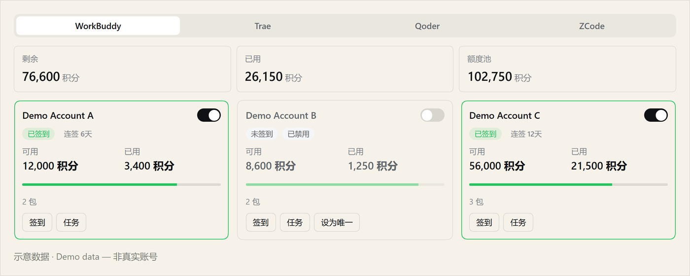

<picture>
  <source media="(max-width: 600px)" srcset="assets/banner-mobile-en.jpg">
  
</picture>

**I build tools for problems I run into, and share the useful ones.**

Currently working on AI workflows, DeepSeek Harness plugins, and music visualization.

English · [中文](README.zh.md) · [toolboxonline.online](https://toolboxonline.online) — the same work as a web page

## Selected work

### Circle the problem on the page, then hand it to the Agent.

`dsh-web-annotator`

<picture>
  <source media="(max-width: 600px)" srcset="assets/dsh-web-annotator-mobile.png">
  
</picture>

Select part of a page in the DSH Browser, write the comment where you are looking, then send the marked screenshot or the DOM locator into the session.

[View project](https://github.com/cslkkl/dsh-web-annotator) · [npm](https://www.npmjs.com/package/dsh-web-annotator)

### One less console tab: CLIProxyAPI accounts, managed inside DSH.

`dsh-cpa-switch`

<picture>
  <source media="(max-width: 600px)" srcset="assets/dsh-cpa-switch-demo-mobile.png">
  
</picture>

Check balance, check in and switch accounts without leaving the workspace, and let CPA start and stop with DSH instead of by hand.

*Illustration uses fictional demo accounts and demo balances.*

[View project](https://github.com/cslkkl/dsh-cpa-switch) · [npm](https://www.npmjs.com/package/dsh-cpa-switch)

### A record catalogue, arranged as year-rings.

`discography-showcase`

<picture>
  <source media="(max-width: 600px)" srcset="assets/discography-showcase-mobile.png">
  
</picture>

Eight artists' complete studio discographies — 1,104 tracks — read year by year as concentric rings, with official 30-second previews and a full-screen lyric stage for the audio you own locally.

[View project](https://github.com/cslkkl/discography-showcase)

## Open-source contributions

Merged into projects other people maintain: **dsh-workbuddy-bridge** ([#3](https://github.com/dsh-plugin-lab/dsh-workbuddy-bridge/pull/3), [#4](https://github.com/dsh-plugin-lab/dsh-workbuddy-bridge/pull/4)) and **Cogniform/imagora** ([#2](https://github.com/Cogniform/imagora/pull/2)).

🐾 <em>Keep sniffing, keep shipping.</em> 
Mostly fixing bugs in tools I wrote for myself.

