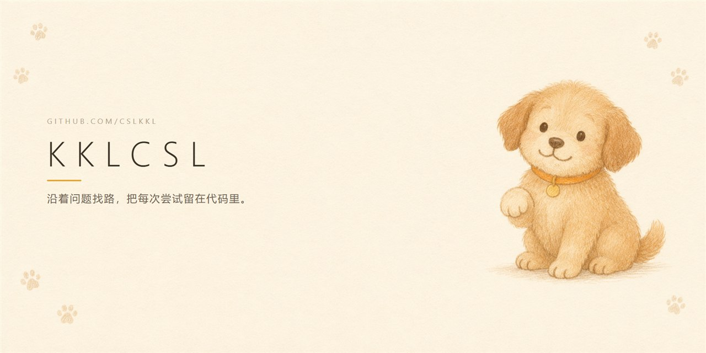

  

  <strong>DeepSeek Harness 插件作者 · 前端可视化</strong> 
  <a href="https://toolboxonline.online">toolboxonline.online</a>

  <a href="README.md">中文</a> · <a href="README_en.md">English</a>

---

### 🐾 关于我

- **在写插件** — 让 DeepSeek Harness 里少几趟手动操作：账号管理、网页批注
- **在做作品** — 把唱片目录做成看得见的年轮，零依赖、可离线
- **在上游** — 向 `dsh-workbuddy-bridge`、`awesome-dsh-plugin`、`Cogniform/imagora` 提交过已合并的 PR
- **联系方式** — 通过 [GitHub Issues](https://github.com/cslkkl) 找我

---

### 精选项目

**DSH 插件**

- **[dsh-cpa-switch](https://github.com/cslkkl/dsh-cpa-switch)** · [npm](https://www.npmjs.com/package/dsh-cpa-switch) 
  在 DeepSeek Harness 里管理 CLIProxyAPI 的账号——看余额、签到、跑任务、切账号，不用再开网页控制台。

- **[dsh-web-annotator](https://github.com/cslkkl/dsh-web-annotator)** · [npm](https://www.npmjs.com/package/dsh-web-annotator) 
  在 DSH 原有的 Browser 标签页里点选或框选网页，就地写评论、向当前 Agent 提问，再把标记截图或 DOM 定位发给会话。

**前端可视化**

- **[discography-showcase · 声之年轮](https://github.com/cslkkl/discography-showcase)** 
  把一位歌手的完整录音室目录做成唱片年轮：8 位歌手、1104 首曲目、14 个展示面、官方 30 秒试听、全屏歌词舞台。零依赖、零构建、可离线。

**上游贡献**

- **[dsh-workbuddy-bridge](https://github.com/dsh-plugin-lab/dsh-workbuddy-bridge)** — 2 个 PR 已合并：消息消耗积分显示、模型默认档位上报
- **[awesome-dsh-plugin](https://github.com/awesome-dsh-plugin/awesome-dsh-plugin)** — 收录 dsh-web-annotator 的 PR 已合并
- **[Cogniform/imagora](https://github.com/Cogniform/imagora)** — 提示词输出与便携发布的 PR 已合并

---

### 技术栈

  
  
  
  
  
  

**生态与工具**

  
  
  
  
  
  

---

### 数据

  <strong>7</strong> 个公开仓库 · <strong>3</strong> 个 npm 包 · <strong>4</strong> 个已合并的上游 PR

  
  
  
  

---

🐕 <em>Keep sniffing, keep shipping.</em>

