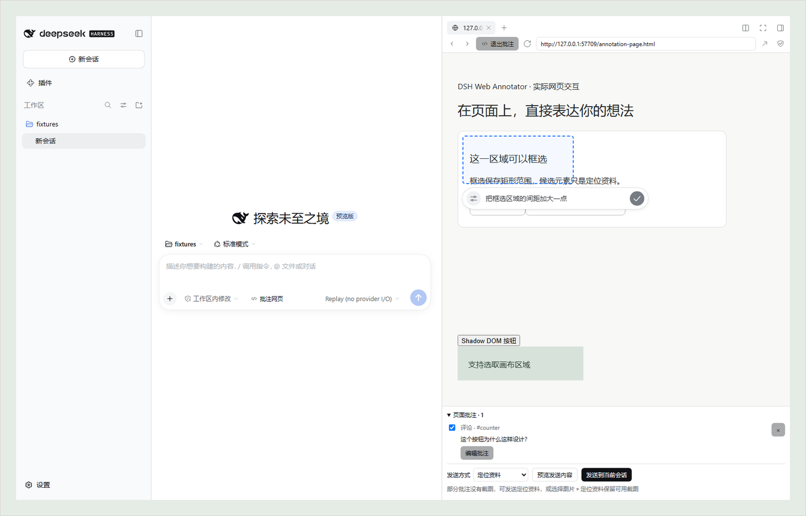
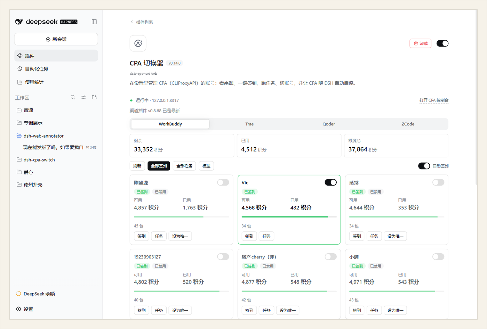
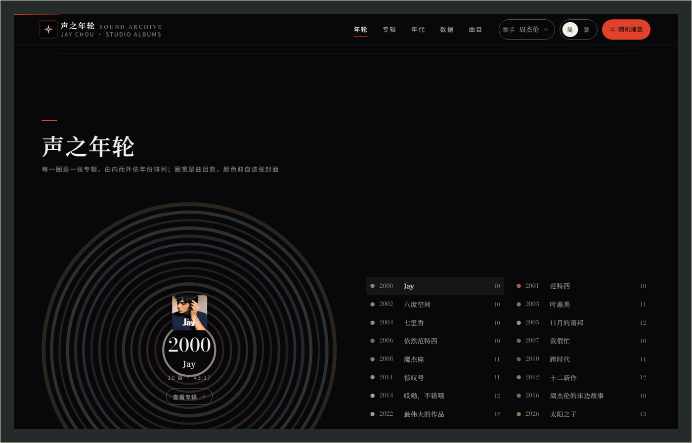

<picture>
  <source media="(max-width: 600px)" srcset="assets/banner-mobile-zh.jpg">
  
</picture>

**为自己遇到的问题做工具，也把好用的部分开源。**
最近主要折腾 AI 工作流、DeepSeek Harness 插件和音乐可视化。
（[English](README.md) · 中文 · [toolboxonline.online](https://toolboxonline.online) —— 同样这些作品的网页版）

## 精选作品

### dsh-web-annotator

**在网页上圈出问题，直接交给 Agent。**
在 DSH 的 Browser 里选中页面的一块，就地写批注，再把标记截图或 DOM 定位发进会话。

[查看项目](https://github.com/cslkkl/dsh-web-annotator) · [npm](https://www.npmjs.com/package/dsh-web-annotator)

### dsh-cpa-switch

**少开一个控制台，在 DSH 里管理 CLIProxyAPI 账号。**
看余额、签到、切换账号都在当前工作界面完成；CPA 跟着 DSH 一起启停，不用再手动接模型。

[查看项目](https://github.com/cslkkl/dsh-cpa-switch) · [npm](https://www.npmjs.com/package/dsh-cpa-switch)

### discography-showcase

**把唱片目录，排成可以浏览的年轮。**
八位歌手的完整录音室目录、1,104 首曲目，按年份一圈圈读下去；每首都可听官方 30 秒试听，本机音源可以开全屏歌词舞台。

[查看项目](https://github.com/cslkkl/discography-showcase)

## 参与的开源项目

已合并进别人维护的仓库：

- **dsh-workbuddy-bridge** —— 每条回复的积分消耗、模型选择器旁的剩余积分（[#3](https://github.com/dsh-plugin-lab/dsh-workbuddy-bridge/pull/3)）；每个能切档位的模型上报默认档位，去掉选择器里没有信息量的「Default」（[#4](https://github.com/dsh-plugin-lab/dsh-workbuddy-bridge/pull/4)）
- **Cogniform/imagora** —— 提示词出图流与零安装的 Windows 便携版发布（[#2](https://github.com/Cogniform/imagora/pull/2)）

另有 dsh-web-annotator 被 [awesome-dsh-plugin](https://github.com/awesome-dsh-plugin/awesome-dsh-plugin/pull/6833) 收录。

🐾 <em>Keep sniffing, keep shipping.</em>
大部分时间在给自己写的工具修 bug。

